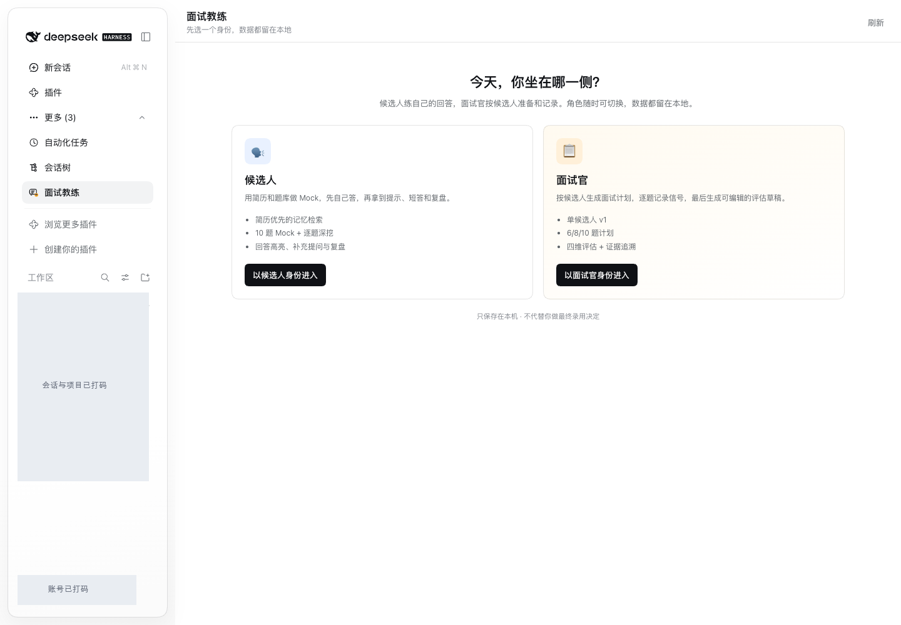
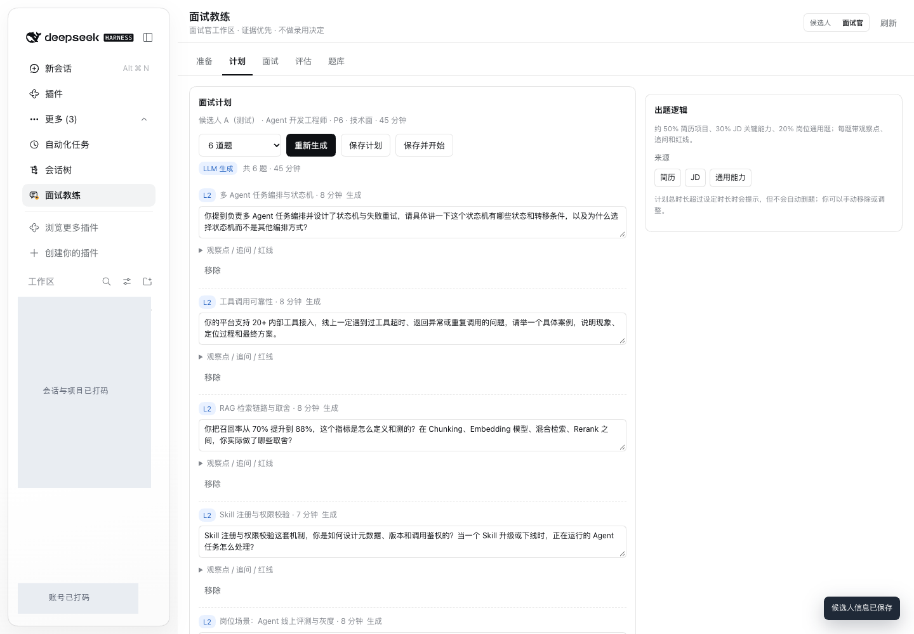

# DSH Interview Coach

Mock-first 面试教练插件：把 Agent / LLM 应用开发题库、简历优先的记忆、模拟面试和复盘放进 DeepSeek Harness。

> 当前版本是 **0.6.1（Mock + 深挖 + 补充提问 + 回答逐句复盘 + 个性化题库 + 回答库 + 面试官模式 v1）**。它不采集系统音频、不接摄像头、不依赖 TTS，也不在面试中替候选人说话；它先解决“题库 + 简历记忆 + 模拟问答 + 复盘”这条闭环。

## 两种身份

首次进入先选身份，之后可在右上角切换；两边数据隔离：

- **候选人**：设置 → Mock → 复盘 → 回答库 → 题库，按简历练自己的回答。
- **面试官**：准备 → 计划 → 面试 → 评估 → 题库，按一位候选人的材料准备、记录和整理评估草稿。

面试官模式 v1 只支持单候选人，不做实时 HUD，也不替面试官做录用决定。详见 [docs/interviewer-mode.md](docs/interviewer-mode.md)。

## 当前能做什么

- **Setup**：粘贴简历、目标 JD、补充材料；支持 `.txt` / `.md` / `.docx` 导入（`.docx` 走 macOS `textutil`，PDF 请粘贴文本）。
- **Memory**：把简历、JD、补充材料拆成卡片，保留来源权重；简历权重最高，冲突时优先简历。检索使用 BM25 + 本地哈希向量 + 来源权重的混合排序。
- **Mock**：从 120 道预置 Agent 题 + 本地“我的题”中抽题（L0–L4，每级 24 道，40 道精修）；可选 `mixed / preset / personal` 三种题源，逐题作答；HUD 在作答时只显示题号/计时，不显示答案。
- **Personal Bank**：在 Bank 页从简历、JD、补充材料生成 5/10/20 道个性化题，先预览再决定是否加入；加入后只存本地，不改动 120 道预置题库；可直接用“仅我的题”开一场 Mock。
- **Feedback**：提交后调用 DSH `ctx.llm.stream`，按 `cue → short_answer → full_answer` 生成提示、短答和完整参考；同时显示你的原话，正确片段绿色高亮、错误片段橙色高亮，并列出纠正和遗漏。模型失败或返回非法 JSON 时自动回退到题库答案。
- **Deep Dive**：主问题提交后可继续三层追问（机制与细节 → 边界与权衡 → 实战与度量）；每层单独评分，生成下一问，最后汇总深挖均分与重复缺口。
- **补充提问**：参考答案下方自动给出 3 个可点击的追问，也可以输入自己的问题；每次回答都会先给“参考回答”，再给“解释与补充”，并生成新的可点追问，适合反复问答把一道题摸透。
- **Review**：汇总平均分、维度分、重复出现的 gap 和逐题改进点；深挖记录挂在原题下，并参与深度维度；可重新开始一轮。
- **Answer Library**：每次提交主题回答/深挖回答后自动保存到本地回答库；可按题目、答案、知识点搜索，按 L0–L4、分数段筛选，收藏重点回答；深挖回答会标注母题。
- **HUD**：候选人的 `shell.overlay` 常驻；待机时默认收成 32px 小圆点，点开才显示题量/记忆，避免挡住正常会话；作答、提交后和深挖时都可折叠，提交后的小条显示分数；深挖作答时只显示追问和计时，不展示答案；`⌘⇧H` panic hide，`Esc` 折叠已展开的答案。

## 还没做（明确边界）

- 面试官模式 v1 只支持单候选人；多候选人对比、面试安排、人才库未做。
- 实时 ASR / 面试官与候选人分离：当前 Mock 使用文字题卡；麦克风转写和火山流式 ASR 是下一阶段。
- 系统音频、视频、手机采集、BlackHole：未接入。
- TTS：未接入；配置项保留但默认关闭。
- 真正的 BGE-small 模型：当前 `lib/memory.js` 是确定性的本地哈希词向量（无网络、无模型下载），用于先把检索链路跑通；BGE ONNX 适配器是后续替换点。
- GitHub/博客自动抓取：未实现；当前通过 Setup 的补充材料承接。个性化题由已导入的记忆生成，不自动抓取外部内容。
- 联网搜索：当前答案只基于 Setup 记忆 + 题库；`ctx.web.search` 尚未接入，避免在无搜索 provider 时阻塞 Mock。
- 屏幕共享保护：`shell.overlay` 是 HTML 层，无法从屏幕捕获中排除；正式面试请使用第二块屏幕/手机，或明确接受暴露风险。

## 截图

> 截图中的账号、项目与会话列表已打码。





## 安装

在 DSH 中通过 Plugin Manager 安装本目录（不要手改 profile）：

```text
plugin_manager install_bundle  <本目录绝对路径>
```

也可以直接从 GitHub 安装：

```bash
dsh plugin --profile <profile> add github:jasoncai0/dsh-interview-coach
```

安装后刷新 DSH Web GUI。插件会出现在侧边栏“面试教练”。配置在 `cordis.patch.yml`：

```yaml
provider: deepseek-account
model: deepseek-flash
mockQuestionCount: 10
embeddingProvider: local
ttsEnabled: false
```

模型不可用时，反馈会自动回退到题库参考答案，不会让 Mock 卡死。

## 使用

1. 首次打开“面试教练”先选身份；候选人进入 **Setup**，面试官进入 **准备**。
2. 候选人：粘贴简历（必须）、JD、补充材料，保存。
3. 到 **Mock**，选择题量/层级/主题，开始。
4. 用自己的话回答；HUD 只显示题目和计时。
5. 提交后先看“你的回答”：绿色是正确片段，橙色是需纠正片段；下面有逐条纠正和遗漏。再对照 `cue`、`short_answer`、`full_answer`；在“补充提问”里点自动生成的问题，或输入自己的追问，反复问参考答案；也可以点“开始深挖”继续三层追问，或直接进入下一题。
6. 结束后到 **Review** 看总分、维度分、深挖均分和改进行动。
7. **回答库** 可按题目、答案、知识点搜索历史回答，按层级/分数筛选，收藏后再练。
8. **Bank** 可浏览预置题和“我的题”；点“从记忆生成”先预览，再“加入我的题”。之后在 Mock 的“题目来源”里选“仅我的题”或“混合”。

面试官路径：首次进入选 **面试官** → **准备** 填候选人和简历/JD → **计划** 生成/编辑 6/8/10 题 → **面试** 逐题记录回答、笔记和信号 → **评估** 查看/修订四维证据草稿。

## 数据位置

```text
$DSH_HOME/storages/interview-coach/
  profile.json
  memory.json
  sessions.json
  personal-bank.json
  answer-bank.json
  interviewer/
    candidates/*.json
    plans/*.json
    sessions/*.json
```

所有写入是原子替换；卡片 embedding 不落盘，加载时重建。预置题库在 `bank/agent.jsonl`，按级别拆分在 `bank/L0.jsonl` … `L4.jsonl`；个性化题在 `personal-bank.json`，历史回答在 `answer-bank.json`，都只属于本机。回答库最多保留 1000 条，收藏状态不会因重复提交丢失。

## 故障处理

- 页面提示“这轮 Mock 已失效”时，说明本地页面还持有已经被清理或重启前的 session；客户端会自动清掉旧状态，重新开始一场即可。
- 插件重启/升级后如果侧边栏仍是旧界面，刷新一次 DSH Web GUI；不要继续在旧页面里提交上一轮的答案。
- 同一时间只保留一个 active Mock；新开一场会把旧的未完成 session 标记为 abandoned，避免 HUD 和复盘串场。
- “从记忆生成”提示 `NO_MEMORY` 时，先在 Setup 保存简历/JD/补充材料；个性化题生成失败不会影响预置题库和正在进行的 Mock。
- 删除“我的题”时若该题正被 active Mock 使用，会返回 `PERSONAL_IN_USE`；先结束或重开 Mock 再删。
- 回答库为空时，先完成一次 Mock 提交；旧 session 会在插件启动时自动回填到回答库。回答库写入失败不会影响当前答题。

## 开发

```bash
cd dsh-interview-coach
npm test
node --check lib/index.js
node --check lib/client.js
```

题库生成脚本：

```bash
node scripts/make-l0.mjs > bank/L0.jsonl
# …L1–L4
node -e "..."  # 合并为 bank/agent.jsonl
```

## 设计文档

架构、记忆权重、Prompt 约束、深挖设计和 P5/P6 路线：

- [docs/design.md](docs/design.md)
- [docs/deep-dive.md](docs/deep-dive.md)
- [docs/interviewer-mode.md](docs/interviewer-mode.md)

## License

MIT
